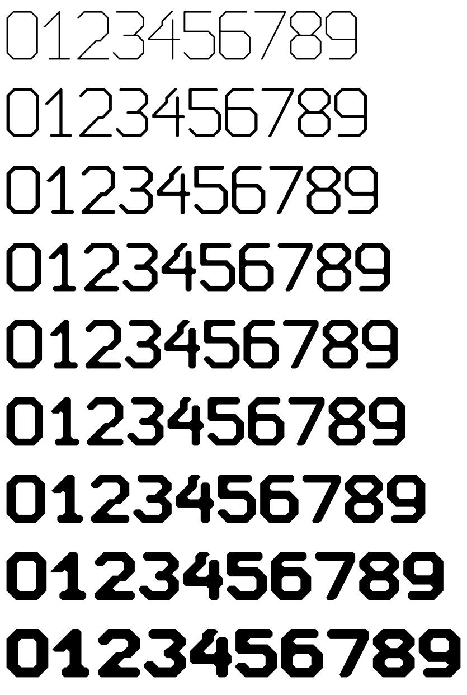
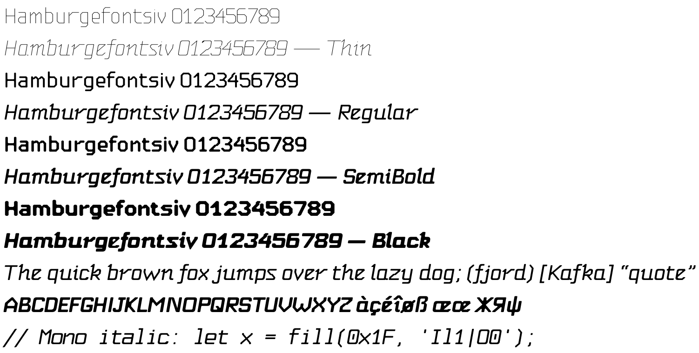

# Arris

A typeface grown from the Chamfer clock figures of the
[Dymaxion watch face](https://github.com/huntrontrakkr/dymaxion-watch-face).

An *arris* is the sharp edge where two faces meet; a chamfer is what you get
when you break it. Arris is built the way the watch figures were: a drawing on
a module grid, one rule for corners, and nothing drawn by hand that the rule
can generate. At the watch's weight its figures are the watch's figures,
pixel for pixel.





## Families

| Family | What it is |
|---|---|
| **Arris** | Proportional letters, tabular figures. Measured optics. Nine weights. |
| **Arris Watch** | The same with the watch's own stroke balance (diagonals as wide across as a stem). |
| **Arris Italic**, **Arris Mono Italic** | Slanted ten degrees, every chamfer a curve, every point the upright keeps sharp kept sharp; a single-storey a and a descending f. Nine weights each. |
| **Arris Mono** | Every glyph on the figures' 10-module pitch: slabbed I, footed i l r, dotted zero. |
| **Arris[GRAD,WTCH,wght]**, **Arris-Italic[GRAD,WTCH,wght]** | Variable: weight 100–900, grade −100–100, watch proportions 0–100; linked as one family on the `ital` axis. |

Coverage: Latin (Western, Central and Eastern European, Turkish, Baltic,
Romanian), Cyrillic (Russian, Ukrainian, Belarusian, Bulgarian, Serbian,
Macedonian), Greek (monotonic). Features: `tnum` (default) `pnum` `calt`
(the watch's time colon between figures) `zero` `ss01` `sups` `subs`
`sinf` `numr` `dnom` `frac` `ordn` `case` `kern`.

## Building

```
uv sync
uv run python tools/build_fonts.py              # Arris, all weights
uv run python tools/build_fonts.py all watch    # Arris Watch
uv run python tools/build_fonts.py all mono     # Arris Mono
uv run python tools/build_fonts.py all italic   # Arris Italic (add mono for Arris Mono Italic)
uv run python tools/build_vf.py                 # the variable font, with its interpolation check
uv run python tools/build_vf.py italic          # the italic variable font
uv run pytest                                   # the figures against the watch's pixels
```

Fonts land in `build/`. Proof tools: `tools/master_sheet.py` (pixel
masters), `tools/overlay.py` (constructions over masters),
`tools/weights_sheet.py`, `tools/hbspec.py` (shaped with HarfBuzz, rendered
with FreeType, features and axes as arguments).

## How it is made

`docs/DESIGN.md` explains what the watch figures do, the corner rule, how
letters were drawn in the same language, how weights keep their openings,
and where the optical corrections come from. In short:

* `heritage/`: the watch's pixel masters, copied verbatim.
* `src/arris/masters.py`: pixel masters for the letters.
* `src/arris/geom.py`: strokes to ink. Centrelines with direction-dependent
  thickness, chamfered bowls, and the watch's corner rule on the union.
* `src/arris/glyphs/`: every glyph as a construction in its master's
  coordinates, with its openings declared.
* `src/arris/vision.py`, `src/arris/spacing.py`, `src/arris/kerning.py`:
  measuring instead of eyeballing.
* `src/arris/variable.py`: making masters point-compatible after the fact.
* `src/arris/italic.py`: the italic, from the upright drawings.
* `tools/confusion.py`, `tools/letter_confusion.py`: which figures and
  letters a reader could mistake for one another, against legibility faces
  (`docs/research/legibility.md`).

## Licence

The watch's Draft lettering in `heritage/` is Apache-2.0 (Dymaxion
contributors). Arris is intended for release under the SIL Open Font Licence
1.1.
